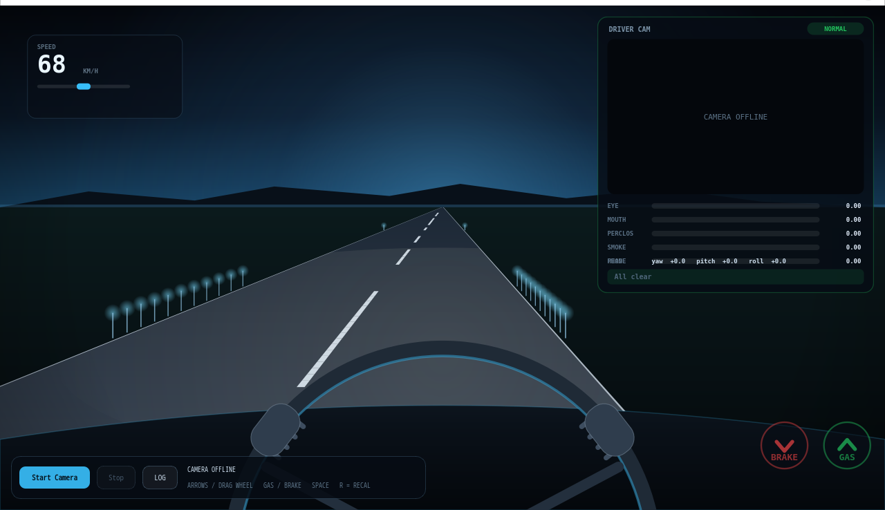
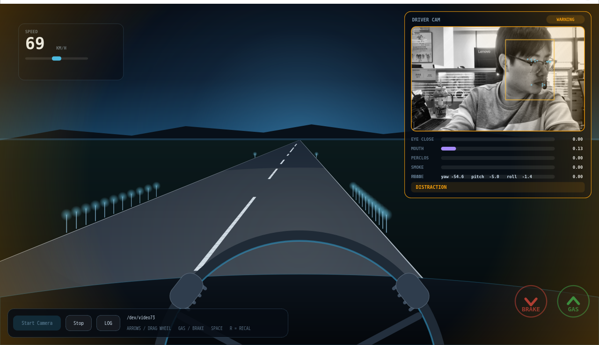
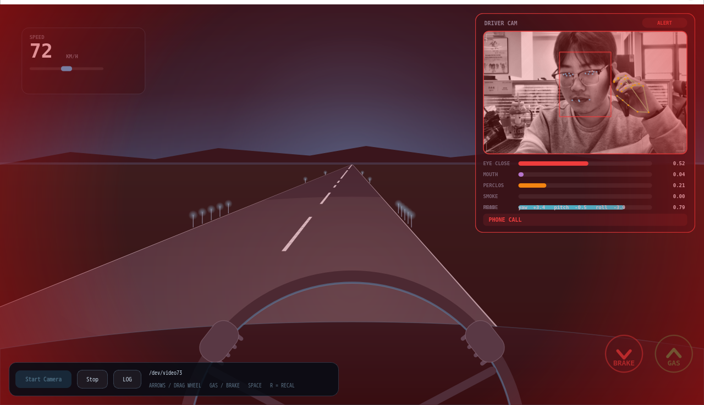

# demo-dms-monitor

[中文](README.zh-CN.md)

A driver monitoring system (DMS) demo built with PySide6 + ONNX Runtime, designed for a 940 nm infrared USB camera.

The whole window is a first-person driving view that simulates a real driving environment; the driver camera, live metrics, alert level and voice prompts all float on top of it.


## Features

- **Cockpit-style UI**: a QPainter-drawn road scene with steering wheel and pedals, a `DRIVER CAM` panel in the top-right corner, and a three-level alert state (green / amber / red) with full-screen pulse feedback.
- **468-point face mesh and 21-point hand skeleton** drawn live on the preview, with temporal smoothing so the overlay does not jitter.
- **Behavior detection**: drowsiness (closed eyes / PERCLOS / yawning), distraction (yaw / pitch / roll), smoking, phone calls, and driver-not-visible.
- **Three project-trained classifiers** (`eye_state`, `smoke`, `phone`) on top of the MediaPipe base models, because the geometry-only rules are unreliable on IR imagery, especially with glasses.
- **IR-ready pipeline**: grayscale/IR streams are detected automatically and enhanced with CLAHE before inference.
- **Voice alerts**: one dedicated Mandarin prompt per violation, played through ALSA without touching the system volume.
- **Robust runtime**: automatic camera reconnect, rolling posture baseline, and per-module debug switches.

## Detection rules

| Item | Cue | WARNING | ALERT |
| --- | --- | --- | --- |
| Eyes closed | `eye_state` closed probability > 0.5 | 1.0 s continuous | — |
| PERCLOS | share of closed frames in the window | ≥ 0.35 | ≥ 0.50 |
| Yawning | Mouth aspect ratio > 0.45 | 0.8 s continuous | — |
| Distraction | \|yaw\| > 30° / \|pitch\| > 20° / \|roll\| > 30° | 1.5 s continuous | 3.0 s continuous |
| Smoking | `smoke` probability > 0.6 with hand-near-mouth gate | 1.2 s continuous | 2.5 s continuous |
| Phone call | `phone` probability > 0.5 with hand-near-ear gate | 1.2 s continuous | 2.5 s continuous |
| Driver not visible | no face for N seconds | 2.5 s | 5.0 s |

## How it works

```
Capture thread            Frame slot (mutex)           Face thread (~12 Hz)
OpenCV VideoCapture  ──▶  newest frame + id  ──▶  BlazeFace / FaceMesh / eye / smoke / phone
      │                        │                        │
      │                        └──▶ Hand thread ─────────┘   (BlazePalm + 21 landmarks, 2.5 Hz)
      │                                  │
      └── scale + draw overlay + emit QImage ──▶ Qt UI (panel, alert layer, voice)
```

- **Preview and inference are decoupled.** The capture thread only reads, enhances, downscales to 400 px and paints annotations; inference runs on the latest frame in separate threads. The preview stays at camera frame rate (about 25 fps on the board) instead of dropping to 5–7 fps while hands are being detected.
- **Face tracking with verification.** Once a face is found, FaceMesh runs on the previous bbox and BlazeFace re-runs only once per second; FaceMesh's own face-presence score is used to reject false detections admitted by the low (0.3) threshold.
- **Hand detection is throttled to 0.4 s** because Palm + Hand costs ~180 ms per pass. Results are cached for 1 s so a single miss does not reset the phone/smoking timers, and landmarks are smoothed before they feed the geometric gates and ROI crops.
- **ROI crops use only the hand nearest the ear/mouth.** A stray palm detection on a sleeve or keyboard would otherwise blow the ROI up to the whole frame and flip the classifier score.
- **Posture baseline is rolling, not fixed.** A 300-frame median defines the zero pose; if the head stays out of range for 20 s the baseline re-anchors, so a wrong pose at startup does not cause permanent false distraction alerts.

## Requirements

- Python 3.9+ (the validated setup is Debian 13 aarch64 / Python 3.13)
- A UVC camera, 1280×720 MJPG requested by default
- A 940 nm IR camera with the IR-cut filter removed is recommended; 850 nm emitters are visible as a red glow at night

The only system package needed is the venv tooling itself:

```bash
sudo apt install -y python3-venv
```

Create and populate a virtual environment, then install the dependencies into it:

```bash
cd dms
python3 -m venv .venv
source .venv/bin/activate
pip install -r requirements.txt
```

## Run

Activate the environment first:

```bash
cd dms
source .venv/bin/activate
python3 src/main.py
```

Click **Start Camera**, then sit facing the camera for about 3 seconds so the posture baseline settles.




### Environment variables

| Variable | Default | Description |
| --- | --- | --- |
| `DMS_MODELS` | `models/` | Model directory |
| `DMS_IR` | `auto` | `auto` detects grayscale/IR streams and applies CLAHE; `1` / `0` forces it |
| `DMS_PREVIEW_W` | `400` | Preview width in pixels before annotation |
| `DMS_ANALYZE_HZ` | `12` | Face/behavior analysis rate |
| `DMS_HAND_INTERVAL` | `0.4` | Seconds between hand detections |
| `DMS_PALM_THRESHOLD` | `0.3` | BlazePalm score threshold (lowered for phone-held-to-ear poses) |
| `DMS_HAND_GRACE` | `1.0` | Seconds to keep the last hand result after a miss |
| `DMS_EYE_MAX_PITCH` / `DMS_EYE_MAX_YAW` | `18` / `45` | Pose limits outside which the eye model is not trusted |
| `DMS_MESH_MIN_SCORE` | `0.5` | FaceMesh presence score required to accept a detection |
| `DMS_SMOOTH_ALPHA` | `0.7` | Landmark EMA coefficient (higher = snappier) |
| `DMS_HAND_SMOOTH` | `0.5` | Hand landmark EMA coefficient |
| `DMS_THREADS` | `2` | ONNX Runtime intra-op threads |
| `DMS_PHONE_PROB` | `0.5` | Phone classifier threshold |
| `DMS_FPS_DEBUG` | unset | `1` prints the preview FPS every 2 s |
| `DMS_GATE_DEBUG` / `DMS_PHONE_DEBUG` / `DMS_SMOKE_DEBUG` / `DMS_EYE_DEBUG` | unset | `1` prints per-module debug lines |
| `DMS_DUMP_NOFACE` | unset | `1` saves a frame to `/tmp/noface/` every 2 s while no face is found |

Behavior thresholds themselves live at the top of [src/behaviors.py](src/behaviors.py).

## Interface guide

The window has three layers: the driver panel, the control bar with log, and the alert overlay.

### Driver panel (`DRIVER CAM`)

| Element | Meaning |
| --- | --- |
| Level badge | `NORMAL` (green) / `WARNING` (amber) / `ALERT` (red), with a pulsing border |
| Preview | Camera image with face box, eye/mouth landmarks and hand skeleton |
| `NO FACE` banner | Shown over the preview while no driver face is tracked |
| `EYE CLOSE` | Closed-eye probability from `eye_state.onnx` (falls back to EAR if the model is missing) |
| `MOUTH` | Mouth aspect ratio, used for yawning |
| `PERCLOS` | Share of closed-eye samples in the rolling window |
| `SMOKE` | Smoking classifier probability |
| `PHONE` | Phone-call classifier probability |
| `HEAD` | Yaw / pitch / roll in degrees, relative to the rolling baseline |
| Bottom line | Active alert messages, e.g. `PHONE CALL`, or `All clear` |

### Control bar and log

| Element | Action |
| --- | --- |
| `Start Camera` | Loads models and opens the camera; disabled while running |
| `Stop` | Stops analysis and releases the camera |
| `LOG` | Toggles the log panel, same as the `D` key |
| Status text | Active device node, e.g. `/dev/video0` |
| Log panel | State changes and metrics, also mirrored to stdout for post-run checks |

### Alert overlay

| Level | Visual |
| --- | --- |
| `WARNING` | Amber glow around the screen edges |
| `ALERT` | Full-screen red pulse |

## Models

`models/` ships seven ONNX models. The four base models are exported from MediaPipe (Apache-2.0, via github.com/yakhyo):

| File | Purpose |
| --- | --- |
| `face_detection_short_range.onnx` | BlazeFace face detection, 128×128 |
| `face_mesh_Nx3x192x192.onnx` | FaceMesh, 468 landmarks, 192×192 |
| `palm_detection.onnx` | BlazePalm hand detection, 192×192 |
| `hand_landmark.onnx` | Hand landmarks, 21 points, 224×224 |

The other three are project-trained MobileNetV3-small classifiers:

| File | Purpose | Input |
| --- | --- | --- |
| `eye_state.onnx` | Open / closed eyes (EAR is unreliable on IR with glasses) | 2 × 96×96 grayscale eye crops |
| `smoke.onnx` | Smoking | 128×128 hand–mouth ROI |
| `phone.onnx` | Phone call | 128×128 hand–ear ROI |

Each classifier has a matching `.txt` with sample counts and validation metrics.

## Project layout

```
dms/
├── README.md                # English
├── README.zh-CN.md          # 中文
├── requirements.txt
├── assets/                  # voice prompt wav files
├── models/                  # 7 ONNX models + training info
└── src/
    ├── main.py              # window layout, camera control, keys, logging
    ├── camera.py            # capture / face / hand threads, tracking, smoothing
    ├── models_mp.py         # BlazeFace / FaceMesh / Palm / HandLandmark wrappers
    ├── metrics.py           # EAR / MAR / head pose / PERCLOS
    ├── behaviors.py         # thresholds, alert state machine, posture baseline
    ├── capture.py           # device discovery, IR preparation, reconnect helpers
    ├── overlay.py           # preview annotations
    ├── panel.py             # driver panel and alert overlay painting
    ├── drive.py             # first-person driving scene
    ├── alert.py / audio.py  # voice alerts, ALSA playback
    ├── eye_state.py / eye_crop.py
    ├── smoke.py / hand_crop.py
    ├── phone.py / phone_crop.py
    ├── collect_*.py         # sample collection on the board
    ├── train_*.py           # training + ONNX export
    └── calibrate_pitch.py   # pitch baseline / nod threshold calibration
```

## Support

If you run into any issue while using this demo, feel free to post on the [Quectel official forum](https://forums.quectel.com/) — the Quectel support team will follow up.
