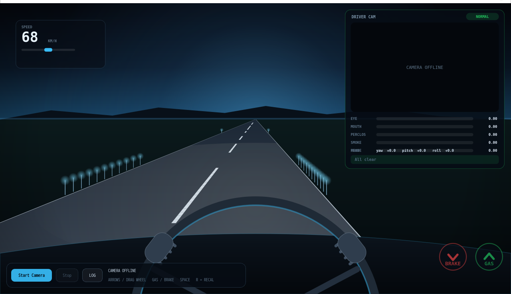
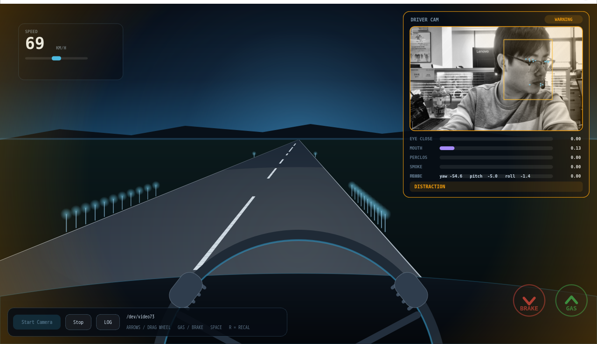
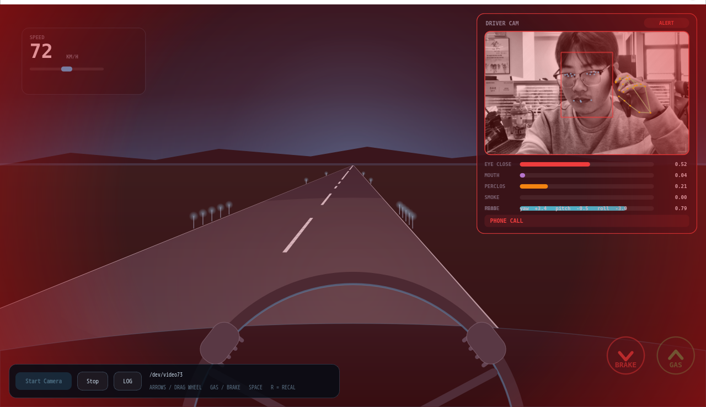

# demo-dms-monitor

[English](README.md)

基于 PySide6 + ONNX Runtime 的驾驶员监控（DMS）Demo，面向 940 nm 红外 USB 摄像头。

整个窗口就是第一人称驾驶画面，模拟真实驾驶环境，驾驶员摄像头、实时指标、告警等级和语音提示全部浮在画面之上。


## 功能特性

- **座舱式界面**：QPainter 绘制的透视路面、方向盘与踏板，右上角是 `DRIVER CAM` 驾驶员面板，告警分绿 / 黄 / 红三级，红色时整屏脉冲闪红。
- **468 点人脸网格 + 21 点手部骨架**实时叠加在预览上，带时域平滑，标注不会逐帧抖动。
- **五类检测**：疲劳（闭眼 / PERCLOS / 哈欠）、分心（偏航 / 俯仰 / 侧倾）、抽烟、打电话、驾驶员不在画面。
- **三个自训分类器**（`eye_state`、`smoke`、`phone`）：红外画面下纯几何规则不可靠（戴眼镜时 EAR 与睁闭眼甚至是反的），所以关键判断交给分类模型。
- **红外适配**：自动识别灰度/红外流并做 CLAHE 增强，再送入模型。
- **语音告警**：每类违规一条专属中文提示音，直连 ALSA 播放，不修改系统音量。
- **运行时健壮性**：摄像头掉线自动重连、姿态零位滚动校准、各模块独立调试开关。

## 检测规则

| 检测项 | 判定依据 | 黄色（WARNING） | 红色（ALERT） |
| --- | --- | --- | --- |
| 闭眼 | `eye_state` 闭眼概率 > 0.5 | 持续 1.0 s | — |
| PERCLOS | 窗口内闭眼帧占比 | ≥ 0.35 | ≥ 0.50 |
| 哈欠 | 嘴部纵横比 > 0.45 | 持续 0.8 s | — |
| 分心 | \|yaw\| > 30° / \|pitch\| > 20° / \|roll\| > 30° | 持续 1.5 s | 持续 3.0 s |
| 抽烟 | `smoke` 概率 > 0.6，且手在嘴边 | 持续 1.2 s | 持续 2.5 s |
| 打电话 | `phone` 概率 > 0.5，且手在耳侧 | 持续 1.2 s | 持续 2.5 s |
| 无人脸 | 连续检不到人脸 | 2.5 s | 5.0 s |

## 工作原理

```
采集线程                  帧槽（互斥）              人脸线程（约 12 Hz）
OpenCV VideoCapture  ──▶  最新帧 + 帧号  ──▶  BlazeFace / FaceMesh / 眼态 / 抽烟 / 打电话
      │                        │                        │
      │                        └──▶ 手部线程 ───────────┘   （BlazePalm + 21 点，2.5 Hz）
      │                                  │
      └── 缩放 + 绘制标注 + 发 QImage ──▶ Qt 界面（面板、告警层、语音）
```

- **预览与推理解耦**：采集线程只负责读帧、红外增强、缩放到 400 px 宽并画标注；推理在独立线程里处理最新帧。板端预览因此能稳定在摄像头帧率（约 25 fps），不会因为要检测手部而掉到 5~7 fps。
- **人脸跟踪 + 置信度复核**：检测到一次人脸后，后续帧直接用上一帧的关键点框跑 FaceMesh，BlazeFace 每秒才重跑一次；同时用 FaceMesh 自带的人脸存在置信度，挡掉低阈值（0.3）放进来的误检。
- **手部检测按 0.4 s 抽帧**：Palm + Hand 单次约 180 ms，开销太大。结果缓存 1 s，单次漏检不会把打电话/抽烟的计时清零；关键点先平滑，再参与几何门限和 ROI 裁剪。
- **ROI 只取离耳朵/嘴最近的那只手**：否则手掌检测在袖子、键盘上的一次误检就会把 ROI 撑到整帧，分类器输出会从 0.15 直接跳到 0.8。
- **姿态零位滚动校准**：用最近 300 帧的中位数作为零位；如果姿态持续超限 20 s 就重新锚定，启动时没坐正也不会一直误报分心。

## 环境要求

- Python 3.9+（验证环境为 Debian 13 aarch64 / Python 3.13）
- UVC 摄像头，默认请求 1280×720 MJPG
- 推荐 940 nm 红外摄像头并移除 IR-cut 滤光片；850 nm 补光在夜间肉眼可见红点，不适合车内

系统里只需要装虚拟环境工具本身：

```bash
sudo apt install -y python3-venv
```

创建虚拟环境并在其中安装依赖：

```bash
cd dms
python3 -m venv .venv
source .venv/bin/activate
pip install -r requirements.txt
```


## 运行

先激活虚拟环境：

```bash
cd dms
source .venv/bin/activate
python3 src/main.py
```

启动后点 **Start Camera**，正对摄像头坐好约 3 秒，让姿态零位收敛。




### 环境变量

| 变量 | 默认值 | 说明 |
| --- | --- | --- |
| `DMS_MODELS` | `models/` | 模型目录 |
| `DMS_IR` | `auto` | `auto` 按画面自动判断红外/灰度并做 CLAHE；`1` / `0` 强制开关 |
| `DMS_PREVIEW_W` | `400` | 标注前的预览宽度（像素） |
| `DMS_ANALYZE_HZ` | `12` | 人脸/行为分析频率 |
| `DMS_HAND_INTERVAL` | `0.4` | 两次手部检测的间隔（秒） |
| `DMS_PALM_THRESHOLD` | `0.3` | BlazePalm 置信度阈值（握拳贴耳时需降低） |
| `DMS_HAND_GRACE` | `1.0` | 漏检后保留上一次手部结果的时长（秒） |
| `DMS_EYE_MAX_PITCH` / `DMS_EYE_MAX_YAW` | `18` / `45` | 超出该姿态时不再采用眼态模型结论 |
| `DMS_MESH_MIN_SCORE` | `0.5` | 接受一次人脸检测所需的 FaceMesh 置信度 |
| `DMS_SMOOTH_ALPHA` | `0.7` | 关键点 EMA 系数（越大越跟手） |
| `DMS_HAND_SMOOTH` | `0.5` | 手部关键点 EMA 系数 |
| `DMS_THREADS` | `2` | ONNX Runtime 推理线程数 |
| `DMS_PHONE_PROB` | `0.5` | 打电话分类阈值 |
| `DMS_FPS_DEBUG` | 未设置 | `1` 时每 2 秒打印一次预览帧率 |
| `DMS_GATE_DEBUG` / `DMS_PHONE_DEBUG` / `DMS_SMOKE_DEBUG` / `DMS_EYE_DEBUG` | 未设置 | `1` 时打印对应模块调试信息 |
| `DMS_DUMP_NOFACE` | 未设置 | `1` 时无人脸期间每 2 秒存一张图到 `/tmp/noface/` |

行为阈值本身集中在 [src/behaviors.py](src/behaviors.py) 顶部。

## 界面说明

界面分四层：驾驶员面板、控制条与日志、告警浮层。

### 驾驶员面板（`DRIVER CAM`）

| 元素 | 含义 |
| --- | --- |
| 等级徽标 | `NORMAL`（绿）/ `WARNING`（黄）/ `ALERT`（红），边框随告警脉冲 |
| 视频小窗 | 摄像头画面 + 人脸框 + 眼/嘴关键点 + 手部骨架 |
| `NO FACE` 条 | 未跟踪到驾驶员人脸时覆盖在画面底部 |
| `EYE CLOSE` | `eye_state.onnx` 输出的闭眼概率（模型缺失时回退显示 EAR） |
| `MOUTH` | 嘴部纵横比，用于哈欠判定 |
| `PERCLOS` | 滑动窗口内的闭眼占比 |
| `SMOKE` | 抽烟分类概率 |
| `PHONE` | 打电话分类概率 |
| `HEAD` | 相对滚动零位的 yaw / pitch / roll（度） |
| 底部提示行 | 当前告警文案，如 `PHONE CALL`；正常时为 `All clear` |

### 控制条与日志

| 元素 | 作用 |
| --- | --- |
| `Start Camera` | 加载模型并打开摄像头，运行中置灰 |
| `Stop` | 停止分析并释放摄像头 |
| `LOG` | 展开 / 收起日志，与 `D` 键等效 |
| 状态文字 | 当前设备节点，如 `/dev/video0` |
| 日志面板 | 状态变化与原始指标，同时打到标准输出，便于事后排查 |

### 告警浮层

| 等级 | 表现 |
| --- | --- |
| `WARNING` | 屏幕四周琥珀色辉光 |
| `ALERT` | 整屏红色脉冲闪烁 |

## 模型文件

`models/` 内含 7 个 ONNX 模型。其中 4 个基础模型由 MediaPipe 导出（Apache-2.0，来自 github.com/yakhyo）：

| 文件 | 用途 |
| --- | --- |
| `face_detection_short_range.onnx` | BlazeFace 人脸检测，128×128 |
| `face_mesh_Nx3x192x192.onnx` | FaceMesh 468 点关键点，192×192 |
| `palm_detection.onnx` | BlazePalm 手掌检测，192×192 |
| `hand_landmark.onnx` | 手部 21 点关键点，224×224 |

另外 3 个是本项目自训的 MobileNetV3-small 分类器：

| 文件 | 用途 | 输入 |
| --- | --- | --- |
| `eye_state.onnx` | 睁眼 / 闭眼（红外 + 眼镜下 EAR 失效，改用纹理分类） | 2 × 96×96 灰度眼区 |
| `smoke.onnx` | 抽烟 | 128×128 手-嘴 ROI |
| `phone.onnx` | 打电话 | 128×128 手-耳 ROI |

每个分类器都有一份同名 `.txt`，记录样本数与验证集指标。

## 目录结构

```
dms/
├── README.md                # English
├── README.zh-CN.md          # 中文
├── requirements.txt
├── assets/                  # 语音提示音 wav
├── models/                  # 7 个 ONNX 模型 + 训练信息
└── src/
    ├── main.py              # 窗口布局、摄像头控制、快捷键、日志
    ├── camera.py            # 采集/人脸/手部三线程、人脸跟踪、平滑
    ├── models_mp.py         # BlazeFace / FaceMesh / Palm / HandLandmark 封装
    ├── metrics.py           # EAR / MAR / 头部姿态 / PERCLOS
    ├── behaviors.py         # 阈值、三级告警状态机、姿态零位
    ├── capture.py           # 设备查找、红外预处理、重连辅助
    ├── overlay.py           # 预览标注绘制
    ├── panel.py             # 驾驶员面板与告警浮层绘制
    ├── drive.py             # 第一人称驾驶场景
    ├── alert.py / audio.py  # 语音告警与 ALSA 播放
    ├── eye_state.py / eye_crop.py
    ├── smoke.py / hand_crop.py
    ├── phone.py / phone_crop.py
    ├── collect_*.py         # 板端采集脚本
    ├── train_*.py           # 训练并导出 ONNX
    └── calibrate_pitch.py   # 俯仰零位 / 低头阈值标定工具
```

## 技术支持与贡献

如在使用过程中遇到问题，欢迎在[移远官方论坛](https://forumschinese.quectel.com/c/quectel-pi/)提交技术咨询，移远技术支持团队将及时为您解答。
